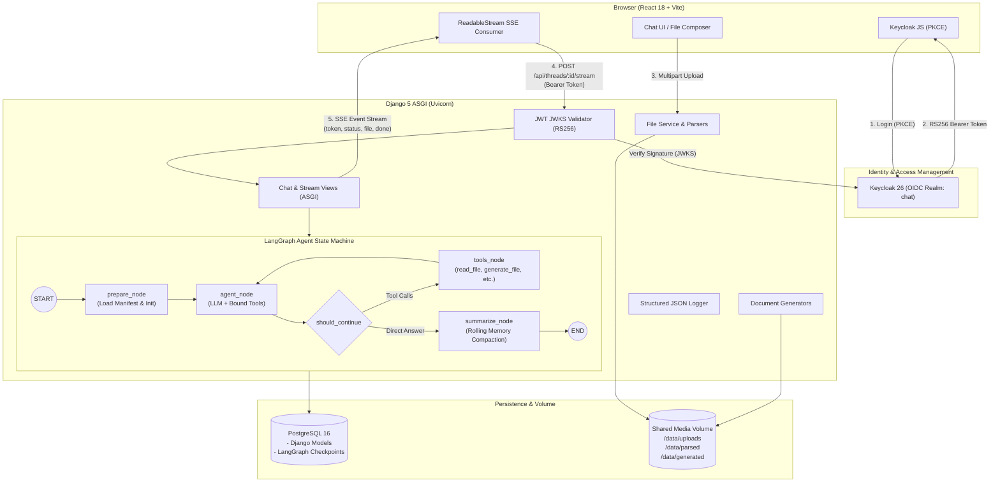

# Chat-AI: Enterprise Agentic Assistant & Document Platform

A full-stack, enterprise-grade AI conversational platform powered by **Django 5 (ASGI / Uvicorn)**, **LangGraph**, **React 18 (Vite)**, **PostgreSQL 16**, and **Keycloak OIDC**. Features real-time Server-Sent Events (SSE) streaming, rolling conversational memory compaction, secure multi-format document parsing, multi-format artifact generation with version revisions, strict object-level multi-tenancy, and defensive prompt-injection guardrails.

---

## Architecture

The following diagram illustrates the end-to-end request lifecycle, authentication boundaries, LangGraph state machine execution, and persistence layers:



---

## Features

- **Real-Time SSE Streaming**: Low-latency token-by-token streaming using native HTTP `ReadableStream` over async Django views, with mid-answer **Stop** (AbortController) and **Regenerate** support.
- **LangGraph State Machine Memory**: Fault-tolerant conversational graphs powered by PostgreSQL checkpointers (`AsyncPostgresSaver`). Conversations survive container restarts and browser refreshes.
- **Rolling Memory Summarization**: Automatically tracks token usage with heuristic and model metadata. When conversations exceed `MAX_TOKENS`, older messages are compacted into a rolling summary while preserving the last `KEEP_LAST` messages verbatim.
- **Comprehensive Document Parsing**:
  - Secure parsing for **PDF** (`pypdf`), **DOCX** (`python-docx`), **XLSX / CSV** (`openpyxl`, `pandas`), **PPTX** (`python-pptx`), **Images** (`PIL`), **Code/Text**, and **JSON**.
  - **ZIP Safety Guardrails**: Enforces max member limits, total uncompressed size limits, path traversal blocking, and nested archive rejection.
- **Structured Artifact Generation & Multi-Version Revisions**:
  - Model can generate **Markdown**, **Code scripts**, **DOCX**, **PDF**, **XLSX**, **CSV**, **PPTX**, and **Matplotlib PNG Charts**.
  - Revisions inspect parent specifications via `read_generated_spec` and generate subsequent versions (`v1 -> v2`) with parent-child linkage.
- **Security & Multi-Tenant Isolation**:
  - Strict object-level permission enforcement across all endpoints, database queries, and agent tools.
  - User-supplied filenames are never stored on disk (random UUID paths).
  - Defensive prompt-injection wrapping: document text is isolated inside `<untrusted_file_content>` XML tags with non-execution directives.
  - MIME type verification with `python-magic` prevents extension spoofing.
- **Keycloak OIDC Integration**: Standard OAuth2 / OIDC PKCE flow, proactive token refresh, automatic session expiration handling, and full client state clearing on logout.
- **Structured JSON Logging**: Request tracing with unique `X-Request-ID` propagation, response timing, and machine-readable JSON logs for observability.
- **Automated Orphan Cleanup**: Sweeper utility and management command to identify and purge uploads never attached to a message.

---

## Tech Stack

| Layer | Technologies |
|---|---|
| **Backend** | Python 3.11+, Django 5.1, Django REST Framework, Uvicorn (ASGI) |
| **Agent / Orchestration** | LangGraph 0.2+, LangChain 0.3+, Psycopg 3 (`AsyncPostgresSaver`) |
| **Frontend** | React 18, Vite, Axios, React Markdown, Remark GFM, PrismJS |
| **Auth** | Keycloak 26 (Dockerized Quay image), `keycloak-js`, PyJWT |
| **Database** | PostgreSQL 16 (Relational tables + LangGraph binary checkpoints) |
| **Parsers & Generators** | `pypdf`, `python-docx`, `openpyxl`, `pandas`, `python-pptx`, `reportlab`, `matplotlib`, `python-magic` |
| **Infrastructure** | Docker Compose v2, Multi-stage Dockerfiles, Docker Volumes |

---

## Prerequisites

- **Docker** (version 24.0+) & **Docker Compose** (version 2.20+)
- Minimum **4 GB RAM** and **10 GB disk space**
- *(Optional, for running without Docker)*: Python 3.11+, Node.js 20+, PostgreSQL 16 server.

---

## Environment Variables

| Variable | Default Value | Description / Purpose |
|---|---|---|
| `POSTGRES_DB` | `aichat` | PostgreSQL database name |
| `POSTGRES_USER` | `postgres` | PostgreSQL administrative username |
| `POSTGRES_PASSWORD` | `postgres` | PostgreSQL administrative password |
| `DATABASE_URL` | `postgresql://postgres:postgres@db:5432/aichat` | Database connection string used by Django and LangGraph checkpointer |
| `SECRET_KEY` | `dev-secret-key-replace-in-production` | Django secret key for cryptographic signing |
| `DEBUG` | `1` | Enable Django debug mode (`0` in production) |
| `ALLOWED_HOSTS` | `localhost,127.0.0.1,backend` | Comma-separated list of permitted host headers |
| `CORS_ALLOWED_ORIGINS` | `http://localhost:3000,http://127.0.0.1:3000` | Permitted cross-origin resource sharing origins |
| `KEYCLOAK_ADMIN` | `admin` | Keycloak administrative console username |
| `KEYCLOAK_ADMIN_PASSWORD` | `admin1234` | Keycloak administrative console password |
| `KEYCLOAK_PUBLIC_URL` | `http://localhost:8080/realms/chat` | Keycloak public URL accessible from the browser for OIDC tokens |
| `KEYCLOAK_INTERNAL_URL` | `http://keycloak:8080/realms/chat/protocol/openid-connect/certs` | Internal container URL used by backend to fetch JWKS public keys |
| `KEYCLOAK_CLIENT_ID` | `chat-web` | Keycloak client identifier configured for PKCE |
| `FAKE_LLM` | `0` | Set to `1` to run deterministic synthetic model responses without an API key |
| `LLM_PROVIDER` | `openai` | Active model provider (`openai`, `anthropic`, `google`) |
| `LLM_MODEL` | `gpt-4o-mini` | Model name passed to provider constructor |
| `OPENAI_API_KEY` | *(empty)* | API key for OpenAI (required if `LLM_PROVIDER=openai` and `FAKE_LLM=0`) |
| `ANTHROPIC_API_KEY` | *(empty)* | API key for Anthropic Claude models |
| `GOOGLE_API_KEY` | *(empty)* | API key for Google Gemini models |
| `MAX_TOKENS` | `6000` | Conversation token ceiling triggering memory compaction |
| `KEEP_LAST` | `8` | Number of recent messages preserved verbatim during compaction |
| `MAX_FILE_SIZE_BYTES` | `26214400` (25 MB) | Per-file upload ceiling |
| `MAX_REQUEST_SIZE_BYTES` | `104857600` (100 MB) | Total request body ceiling across multi-file uploads |
| `MAX_ZIP_MEMBERS` | `100` | Maximum allowable files inside an uploaded ZIP archive |
| `MAX_ZIP_UNCOMPRESSED_SIZE` | `52428800` (50 MB) | Maximum uncompressed payload extracted from an archive |
| `THROTTLE_RATE_UPLOAD` | `60/minute` | DRF upload and download rate limit per user |
| `THROTTLE_RATE_CHAT` | `60/minute` | DRF chat turn and streaming rate limit per user |
| `MEDIA_ROOT` | `/data` | Base filesystem directory for raw, parsed, and generated files |

---

## Quickstart (Setup in 5 Commands)

Clone, configure, build, and launch the complete stack with:

```bash
# 1. Clone repository
git clone https://github.com/RoHit4100/Chat-AI.git && cd Chat-AI

# 2. Prepare environment configuration
cp .env.example .env
# Edit .env and either set FAKE_LLM=1 or add your OPENAI_API_KEY=sk-...

# 3. Launch Docker Compose stack
docker compose up --build

# 4. Open browser
# Navigate to http://localhost:3000

# 5. Log in with pre-seeded demo user:
# Username: demo | Password: demo1234
# (Or click "Register" on Keycloak login page to create a new user)
```

---

## Keycloak Notes

- **Admin Console**: `http://localhost:8080/admin`
  - Credentials: username `admin`, password `admin1234` (from `KEYCLOAK_ADMIN` / `KEYCLOAK_ADMIN_PASSWORD`).
- **Realm & Client Configuration**:
  - The stack automatically mounts [`keycloak/realm-export.json`](file:///e:/GenAi/Chat-AI/keycloak/realm-export.json) at boot.
  - **Realm**: `chat`
  - **Client**: `chat-web` (Public client, Standard Flow + Direct Grants, PKCE `S256`, Web Origins: `http://localhost:3000`).
- **How to Add New Users**:
  1. Open `http://localhost:8080/admin` and select the **chat** realm from the top-left dropdown.
  2. Navigate to **Users** -> **Add user**. Enter a username and email, ensure **Enabled** is toggled ON, and click **Create**.
  3. Switch to the **Credentials** tab, click **Set password**, enter a password, toggle **Temporary** OFF, and save.
- **Why `KEYCLOAK_PUBLIC_URL` and `KEYCLOAK_INTERNAL_URL` Differ**:
  - The user's web browser resolves Keycloak at `http://localhost:8080`. Therefore, Keycloak stamps the token issuer (`iss`) claim as `http://localhost:8080/realms/chat`.
  - The Django backend runs inside the Docker bridge network, where `localhost:8080` would resolve to the backend container itself. The backend connects to `http://keycloak:8080` to retrieve the JSON Web Key Set (JWKS), but verifies that `iss` matches `http://localhost:8080/realms/chat`.

---

## Running Without Docker (Local Development)

If you prefer to run services natively on host machines:

### 1. Start Local PostgreSQL & Keycloak
Ensure PostgreSQL is running locally on port `5432` with database `aichat`. Launch Keycloak on port `8080` or run Keycloak standalone via Docker:
```bash
docker run -p 8080:8080 -e KEYCLOAK_ADMIN=admin -e KEYCLOAK_ADMIN_PASSWORD=admin1234 -v $(pwd)/keycloak/realm-export.json:/opt/keycloak/data/import/realm-export.json:ro quay.io/keycloak/keycloak:26.1.3 start-dev --import-realm
```

### 2. Configure Backend
```bash
cd backend
python -m venv venv
# On Windows: venv\Scripts\activate | On macOS/Linux: source venv/bin/activate
pip install -r requirements.txt

# Run migrations
python manage.py migrate

# Launch ASGI server with Uvicorn
uvicorn config.asgi:application --host 127.0.0.1 --port 8000 --reload
```

### 3. Configure Frontend
```bash
cd frontend
npm install
npm run dev
# Vite runs at http://localhost:3000
```

---

## Running Tests

The test suite runs with automatic SQLite fallback and mock in-memory checkpointer without requiring active network or database instances:

```bash
cd backend
python manage.py test
```

To run individual test modules:
```bash
# Authentication & Core Chat API tests
python manage.py test chat.tests

# Review, Security, Permissions, and Edge Cases
python manage.py test chat.tests_review

# File Service, Parsers, and Document Generators
python manage.py test filesvc.tests
```

All 52 tests execute synchronously in approximately 1 second.

---

## Running the Long-Thread Demo

The repository includes an automated script that exercises rolling summarization across 200+ conversational turns:

```bash
cd backend
python scripts/long_thread_demo.py
```

### What It Does:
1. Creates a fresh thread using the service-token test authentication bypass.
2. Seeds a secret launch code (`OMEGA-42`) in message #3.
3. Pumps 205 conversational turns through the live API with `MAX_TOKENS=200` to trigger successive compactions.
4. Messages older than `KEEP_LAST=8` are summarized by the agent's summarization node, merging older turns into `state.summary`.
5. Prompts the agent at turn #205 for the early launch code; verifies that the agent accurately recalls `OMEGA-42` from its rolling memory summary.

---

## Sample Files Usage

The [`sample_files/`](file:///e:/GenAi/Chat-AI/sample_files/) directory provides pre-packaged test documents:

- **`sample.pdf`**: Sample PDF document for text and table extraction.
- **`sample.docx`**: Rich Microsoft Word document with headings and bullet lists.
- **`sample.xlsx`**: Excel workbook with numerical data for spreadsheet schema analysis.
- **`sample.csv`**: Delimited CSV file with tabular metrics.
- **`sample.pptx`**: PowerPoint slide deck testing presentation parsing.
- **`sample.png`**: Raster image verifying dimension extraction and vision pipeline metadata.
- **`sample.txt` & `sample.py`**: Plain text and Python code file.
- **`sample.json`**: Structured JSON payload.
- **`sample.zip`**: Valid archive demonstrating safe multi-file extraction.

**How to test in UI**: Drag any of these files directly into the chat Composer file drop area. Observe upload progress, parsing status chips, and prompt the agent:
> *"Analyze sample.csv and summarize total revenue by category."*

---

## API Overview

All endpoints (except Keycloak auth endpoints) expect an `Authorization: Bearer <token>` header.

| Endpoint | Method | Description | Throttling |
|---|---|---|---|
| `/api/me/` | `GET` | Return authenticated user profile and Keycloak subject | `chat` (60/min) |
| `/api/threads/` | `GET` | List user's chat threads with aggregated token metrics | `chat` (60/min) |
| `/api/threads/` | `POST` | Create a new conversation thread | `chat` (60/min) |
| `/api/threads/<id>/` | `GET` | Retrieve thread details and message history | `chat` (60/min) |
| `/api/threads/<id>/` | `DELETE` | Delete thread, purge disk files, and drop checkpoints | `chat` (60/min) |
| `/api/threads/<id>/stream` | `POST` | Stream assistant response via SSE (`token`, `status`, `file`, `done`) | `chat` (60/min) |
| `/api/threads/<id>/regenerate` | `POST` | Discard last assistant answer, trim checkpoint, and re-run | `chat` (60/min) |
| `/api/threads/<id>/files/` | `GET` | List uploaded files for the thread | `upload` (60/min) |
| `/api/threads/<id>/files/` | `POST` | Multipart upload (accepts multiple files per request) | `upload` (60/min) |
| `/api/threads/<id>/generated/` | `GET` | List generated files and revisions for the thread | `chat` (60/min) |
| `/api/files/<id>/download/` | `GET` | Secure binary stream download of an uploaded file | `upload` (60/min) |
| `/api/generated/<id>/download/` | `GET` | Secure binary stream download of a generated file | `upload` (60/min) |

---

## Troubleshooting

### 1. Port Conflicts (3000, 8000, 8080, 5432)
- **Symptom**: `Bind for 0.0.0.0:8000 failed: port is already allocated`.
- **Solution**: Check active listeners with `netstat -ano | findstr :8000` (Windows) or `lsof -i :8000` (Linux/macOS) and terminate the conflicting process, or adjust port mappings in `docker-compose.yml`.

### 2. Database Connection Failures at Boot
- **Symptom**: Backend crashes with `psycopg.OperationalError: connection to server on "db:5432" failed`.
- **Solution**: The `backend` container includes a `depends_on` condition checking `db: service_healthy`. Ensure the database healthcheck passes (`pg_isready`).

### 3. Keycloak Slow Startup
- **Symptom**: `Keycloak is initializing...` or 502 Bad Gateway during first boot.
- **Solution**: Keycloak 26 Quarkus runtime takes 15–30 seconds on cold start to import `realm-export.json` and generate cryptography keys. Wait until `Keycloak 26.1.3 started in ...ms` appears in `docker compose logs keycloak`.

### 4. Missing LLM Key
- **Symptom**: `Error: OpenAI API key is missing or invalid.`
- **Solution**: If you do not have an API key, set `FAKE_LLM=1` in `.env` and restart the backend. The platform will operate in deterministic synthetic mode, emulating tool calls, streaming, and file generation without external requests.

### 5. File Limits & Rejection
- **Symptom**: `Upload failed: File exceeds limit of 25.0 MB.` or `ZIP contains directory traversal path`.
- **Solution**: Adjust `MAX_FILE_SIZE_BYTES` or `MAX_REQUEST_SIZE_BYTES` in `.env`. Malicious ZIP files (containing `..` or absolute paths) are intentionally rejected by security validators.

---

## Demo Video Script (3-Act Walkthrough)

### Act 1: Long Thread & Rolling Memory Compaction (0:00 – 1:30)
- **Action**: Open UI, start a new thread titled *"Quarterly Strategy"*.
- **Narrate**: *"Watch how the conversation handles continuous context without exceeding model context windows or token budgets."*
- **Action**: Paste initial project parameters (Project Alpha, Budget $50,000, Target Q3). Continue chatting through several turns.
- **Callout**: Point to the **Token Badge** in the sidebar: `Tokens: 6,420`.
- **Demonstrate**: Show that the backend seamlessly invoked `summarize_node`, consolidated the baseline turns into `state.summary`, and kept recent instructions intact. Ask: *"What was our initial budget for Project Alpha?"* Show the model answering accurately from summary memory.

### Act 2: Multi-File Drag-and-Drop & Tabular Deep Dive (1:30 – 3:00)
- **Action**: Drag `sample.csv` and `sample.docx` from `sample_files/` directly into the Composer.
- **Demonstrate**: Highlight the real-time upload progress bars and status chips updating from `uploading` -> `parsing` -> `ready`.
- **Action**: Prompt the model: *"Inspect sample.csv and give me a summary of total sales by region."*
- **Demonstrate**: Show the real-time status banner: `"Reading file..."`. Show the agent executing `read_file`, receiving bounded chunk data wrapped in prompt-injection boundaries, and rendering markdown tables with calculations.

### Act 3: Artifact Generation & Versioned Revisions (3:00 – 4:30)
- **Action**: Prompt: *"Generate an executive report in Markdown summarizing this data."*
- **Demonstrate**: The agent triggers `generate_file(kind="md", name="sales_report.md", ...)`. An SSE `file` event renders a **FileCard** with a `v1` badge, interactive preview, and download button.
- **Action**: Prompt: *"Update the report to add a Recommendations section at the bottom."*
- **Demonstrate**: The agent calls `read_generated_spec(file_id)`, retrieves the v1 JSON spec, modifies it, and calls `generate_file(based_on=v1_id)`. The FileCard updates live to `v2` with parent-child linkage. Download the file using authenticated blob streaming.

---

## Known Limitations / Architectural Trade-Offs

1. **In-Process Parsing vs. Distributed Task Queue**: File parsing runs inside an ASGI threadpool. For multi-gigabyte files or heavy OCR, this should be offloaded to Celery/Redis workers.
2. **Local Volume vs. Cloud Object Storage**: Files are saved to a Docker volume (`/data`). In high-availability multi-node deployments, replace `LocalStorage` with an S3-compatible backend (MinIO / AWS S3).
3. **No Vector Store / Dense Semantic Search**: Document exploration uses bounded chunks and schema analysis rather than a vector database. Sufficient for short to mid-sized documents, but massive repositories benefit from dedicated vector indexing.
4. **Single-Node SSE Connections**: SSE streams run directly between the browser and Uvicorn. Horizontal scaling requires Redis Pub/Sub backplanes or SSE gateways.