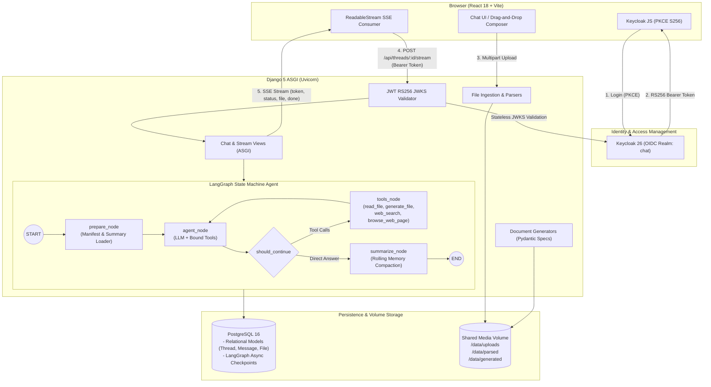

# Chat-AI: Enterprise Agentic Assistant & Document Platform

A production-ready, full-stack conversational AI platform built with **Django 5 (ASGI / Uvicorn)**, **LangGraph**, **React 18 (Vite)**, **PostgreSQL 16**, and **Keycloak OIDC**. Features token-by-token Server-Sent Events (SSE) streaming, rolling memory compaction for 200+ message threads, secure multi-format document parsing, multi-format file generation with revisions, live web browsing with SSRF protection, strict multi-tenancy, and defensive prompt-injection guardrails.

---

## Architecture

The following diagram illustrates the client-server request lifecycle, identity verification, LangGraph state machine execution, and persistence boundaries:



---

## Features

- **Long-Running Chat & Context Compaction**:
  - Handles 200+ message multi-turn conversations without context window overflow.
  - Automatically triggers compaction when conversation tokens exceed `MAX_TOKENS` (default 6,000), compacting older turns into a cumulative rolling summary while preserving the last `KEEP_LAST` messages verbatim.
  - Checkpointed state survives page refreshes and backend container restarts (`AsyncPostgresSaver`).
  - Low-latency SSE streaming with client-side **Stop** (`AbortController`) and **Regenerate** support.
- **Any File In (Universal Document Parsing)**:
  - Drag-and-drop ingestion of **PDF** (`pypdf` + AcroForm + OCR fallback), **DOCX** (`python-docx`), **XLSX / CSV** (`openpyxl`, `pandas`), **PPTX** (`python-pptx`), **Images** (`Pillow`), **Code / Plain Text**, **JSON**, and **ZIP**.
  - Security guardrails: ZIP bomb protection (uncompressed limit 50MB, member limit 100), directory traversal blocking, nested archive rejection, and MIME magic byte verification (`python-magic`).
  - Memory-safe manifest injection: summaries are exposed to the agent; full contents are queried dynamically via `read_file`.
- **Any File Out (Artifact Generation & Revisions)**:
  - Creates real files with downloadable cards in chat: **PDF** (ReportLab with DejaVu Unicode fonts & ATS resume layouts), **DOCX**, **XLSX**, **CSV**, **PPTX**, **PNG charts** (Matplotlib), **Markdown**, and **Code**.
  - Interactive file previews in UI: Markdown preview, tabular CSV/XLSX preview, image preview, and document section breakdown.
  - Spec-based revisions (`based_on` parameter): users can ask to "add a column" or "make it shorter", linking subsequent versions (`v1 -> v2`).
- **Live Web Search & Browsing**:
  - Live internet research via `web_search` (DuckDuckGo integration with fallback) and `browse_web_page` (live HTML extraction with script/style stripping).
  - Robust SSRF protection: blocks private subnets (`10.0.0.0/8`, `172.16.0.0/12`, `192.168.0.0/16`, `127.0.0.0/8`), link-local/cloud metadata (`169.254.169.254`), container names (`db`, `keycloak`, `backend`, `frontend`), and inspects all redirect hops.
  - Defense-in-depth: external search and page data are wrapped in `<untrusted_web_content>` tags.
- **Enterprise Security & Multi-Tenancy**:
  - Keycloak OIDC authentication with PKCE. Tokens verified statelessly via cached JWKS public keys.
  - Strict object-level query isolation across all threads, files, and agent tools.
  - Defensive prompt-injection wrapping for all uploaded and external data.
- **Responsive Modern UI**:
  - Sleek dark-mode interface with glassmorphic cards, syntax-highlighted code blocks, drag-and-drop file upload with progress, and full mobile responsive drawer navigation.

---

## Tech Stack

| Layer | Technologies |
|---|---|
| **Backend** | Python 3.13, Django 5.1.6, Django REST Framework 3.15.2, Uvicorn 0.34.0 (ASGI) |
| **Agent / Workflow** | LangGraph 1.2.17, LangChain Core 1.7.0, Psycopg 3.3.6 (`AsyncPostgresSaver`) |
| **Frontend** | React 18, Vite 5, Axios, Lucide React, React Markdown, Remark GFM, PrismJS |
| **Authentication** | Keycloak 26.1.3 (Dockerized Quay image), `keycloak-js`, PyJWT |
| **Database** | PostgreSQL 16 Alpine (Relational database & binary LangGraph checkpointer) |
| **Parsers & Generators** | `pypdf`, `python-docx`, `openpyxl`, `pandas`, `python-pptx`, `reportlab`, `matplotlib`, `python-magic`, `ddgs`, `primp`, `httpx` |
| **Infrastructure** | Docker Compose v2, Named Docker Volumes, Docker Healthchecks |

---

## Prerequisites

- **Docker Engine** (version 24.0+) & **Docker Compose** (version 2.20+)
- Minimum **4 GB RAM** and **10 GB free disk space**
- *(Optional)*: An OpenAI API key (`OPENAI_API_KEY=sk-...`). If no key is available, `FAKE_LLM=1` can be used to run full deterministic simulations.

---

## Environment Variables

| Variable | Default Value | Meaning / Purpose | Required |
|---|---|---|---|
| `POSTGRES_DB` | `aichat` | PostgreSQL database name | No |
| `POSTGRES_USER` | `postgres` | PostgreSQL username | No |
| `POSTGRES_PASSWORD` | `postgres` | PostgreSQL password | No |
| `DATABASE_URL` | `postgresql://postgres:postgres@db:5432/aichat` | Full database connection string | No |
| `SECRET_KEY` | `dev-secret-key-replace-in-production` | Django secret key for cryptographic signatures | Yes (in prod) |
| `DEBUG` | `1` | Enable Django debug mode (`0` in production) | No |
| `ALLOWED_HOSTS` | `localhost,127.0.0.1,backend` | Permitted host headers | No |
| `CORS_ALLOWED_ORIGINS` | `http://localhost:3000,http://127.0.0.1:3000` | Allowed CORS origins for the frontend | No |
| `BACKEND_URL` | `http://backend:8000` | Backend URL for internal container communication | No |
| `KEYCLOAK_ADMIN` | `admin` | Keycloak administrative console username | No |
| `KEYCLOAK_ADMIN_PASSWORD` | `admin1234` | Keycloak administrative console password | No |
| `KEYCLOAK_PUBLIC_URL` | `http://localhost:8080/realms/chat` | Keycloak URL accessible by browser clients | No |
| `KEYCLOAK_INTERNAL_URL` | `http://keycloak:8080/realms/chat/protocol/openid-connect/certs` | Internal container URL used by backend to fetch JWKS | No |
| `KEYCLOAK_CLIENT_ID` | `chat-web` | Keycloak OIDC client identifier configured for PKCE | No |
| `FAKE_LLM` | `0` | Set to `1` to run deterministic synthetic responses without an API key | No |
| `LLM_PROVIDER` | `openai` | Model provider (`openai`, `anthropic`, `google`) | No |
| `LLM_MODEL` | `gpt-4o-mini` | LLM model identifier | No |
| `OPENAI_API_KEY` | *(empty)* | OpenAI API key | Yes (if `FAKE_LLM=0`) |
| `ANTHROPIC_API_KEY` | *(empty)* | Anthropic Claude API key | No |
| `GOOGLE_API_KEY` | *(empty)* | Google Gemini API key | No |
| `MAX_TOKENS` | `6000` | Token threshold triggering rolling memory compaction | No |
| `KEEP_LAST` | `8` | Number of recent messages preserved verbatim during compaction | No |
| `MAX_FILE_SIZE_BYTES` | `26214400` (25 MB) | Single-file upload limit | No |
| `MAX_REQUEST_SIZE_BYTES` | `104857600` (100 MB) | Total multipart upload limit across files | No |
| `MAX_ZIP_MEMBERS` | `100` | Maximum member files allowed in an uploaded ZIP archive | No |
| `MAX_ZIP_UNCOMPRESSED_SIZE` | `52428800` (50 MB) | Maximum uncompressed payload extracted from an archive | No |
| `THROTTLE_RATE_UPLOAD` | `60/minute` | Upload and download rate limit per user | No |
| `THROTTLE_RATE_CHAT` | `60/minute` | Chat message and streaming rate limit per user | No |
| `MEDIA_ROOT` | `/data` | Base storage path for uploaded, parsed, and generated files | No |

---

## Setup in 5 Commands or Fewer

```bash
# 1. Clone repository
git clone https://github.com/RoHit4100/Chat-AI.git && cd Chat-AI

# 2. Configure environment variables (add your OPENAI_API_KEY or keep FAKE_LLM=1)
cp .env.example .env

# 3. Launch Docker Compose stack
docker compose up --build

# 4. Open application in browser
# Navigate to http://localhost:3000

# 5. Log in with demo credentials:
# Username: demo | Password: demo1234
```

---

## Demo Login Credentials & Keycloak Notes

- **Application URL**: `http://localhost:3000`
- **Pre-Seeded Demo User**:
  - **Username**: `demo`
  - **Password**: `demo1234`
- **Keycloak Administration Console**:
  - **URL**: `http://localhost:8080/admin`
  - **Admin User**: `admin`
  - **Admin Password**: `admin1234`
- **Realm & Client Details**:
  - **Realm**: `chat` (auto-imported from `keycloak/realm-export.json`).
  - **Client**: `chat-web` (Public client, Standard Flow + Direct Grants, PKCE `S256`, Web Origins: `http://localhost:3000`).
  - **User Registration**: Enabled by default; users can click **Register** on the Keycloak login screen to create a new account.
- **Why `KEYCLOAK_PUBLIC_URL` and `KEYCLOAK_INTERNAL_URL` Differ**:
  - Browsers access Keycloak at `http://localhost:8080`, so Keycloak issues tokens with `iss: http://localhost:8080/realms/chat`.
  - The Django container runs inside Docker where `localhost:8080` points to itself. The backend connects to `http://keycloak:8080` to fetch public signing keys (JWKS), but verifies that the token's `iss` matches `http://localhost:8080/realms/chat`.

---

## Supported File Types In and Out

| Direction | Format | Extensions | Library / Engine | Capabilities |
|---|---|---|---|---|
| **Input** | PDF Documents | `.pdf` | `pypdf`, `pdf2image`, `pytesseract` | Plain text extraction, AcroForm fields (`label: value`), OCR rasterization for image-heavy pages |
| **Input** | Word Documents | `.docx` | `python-docx` | Headings, paragraphs, tables, and bullet lists |
| **Input** | Spreadsheets | `.xlsx`, `.xls`, `.csv` | `openpyxl`, `pandas` | Sheet schemas, row counts, column names, bounded row chunk reading |
| **Input** | Presentations | `.pptx` | `python-pptx` | Slide titles, text boxes, and table contents |
| **Input** | Images | `.png`, `.jpg`, `.jpeg`, `.webp` | `Pillow` | Dimensions, color modes, and vision metadata extraction |
| **Input** | Code / Text | `.txt`, `.py`, `.js`, `.json`, etc. | Python standard library | UTF-8 decoded text, structured JSON schemas |
| **Input** | Archives | `.zip` | `zipfile` | Safe multi-file extraction with path traversal and compression bomb protection |
| **Output** | PDF Documents | `.pdf` | `ReportLab` | Professional layout with DejaVu Unicode fonts, ATS resume formatting, headers, bullets |
| **Output** | Word Documents | `.docx` | `python-docx` | Formatted documents with structured sections, tables, and styles |
| **Output** | Spreadsheets | `.xlsx`, `.csv` | `openpyxl`, `pandas` | Tabular data with formatted headers, auto-width columns, formulas |
| **Output** | Presentations | `.pptx` | `python-pptx` | 16:9 widescreen presentation slide decks |
| **Output** | Charts | `.png` | `matplotlib` | High-resolution line charts, bar graphs, scatter plots, and pie charts |
| **Output** | Markdown / Code | `.md`, `.py`, `.js`, etc. | Standard writers | Documentation and runnable code files |

---

## How to Run Tests

The test suite contains **91 comprehensive tests** covering authentication, LangGraph memory compaction, document parsers, file generators, SSRF defenses, and streaming status events.

### Running Inside Docker
```bash
docker compose exec backend python manage.py test chat filesvc
```

### Running Individual Test Suites
```bash
# Web search, live browsing, and SSRF prevention tests (12 tests)
docker compose exec backend python manage.py test chat.tests_web_search

# Core bugfix & regression test suite (14 tests)
docker compose exec backend python manage.py test chat.tests_bugfixes

# File parsing, generators, and validators (27 tests)
docker compose exec backend python manage.py test filesvc.tests

# Multi-tenancy, review, and permissions (27 tests)
docker compose exec backend python manage.py test chat.tests_review
```

---

## How to Run the Long-Thread Demo

The automated long-thread demo script runs **205 conversational turns** through the API with compact memory thresholds to verify rolling summarization and historical fact recall:

```bash
docker compose exec backend python scripts/long_thread_demo.py
```

### What It Validates:
1. Creates a fresh thread via the API.
2. Injects a secret launch code (`OMEGA-42`) in message #3.
3. Pumps 205 turns through the LangGraph engine with `MAX_TOKENS=200`.
4. Compaction node triggers periodically, rolling older turns into `state.summary` while keeping only the last 8 messages in working memory.
5. On turn #205, asks the agent for the launch code; verifies accurate recall from the rolling summary.

---

## Sample Files Usage

The [`sample_files/`](file:///e:/GenAi/Chat-AI/sample_files/) directory provides pre-packaged test documents:

- **`sample.pdf`**: Sample PDF testing plain text extraction.
- **`sample.docx`**: Word document testing headings and bullet lists.
- **`sample.xlsx`**: Excel workbook with tabular data.
- **`sample.csv`**: Delimited CSV file with population metrics.
- **`sample.pptx`**: PowerPoint presentation slide deck.
- **`sample.png`**: Raster image verifying dimension extraction.
- **`sample.txt` & `sample.py`**: Plain text and Python code file.
- **`sample.json`**: Structured JSON schema payload.
- **`sample.zip`**: Safe multi-file archive.

**How to test in the UI**:
1. Drag `sample.csv` and `sample.pdf` into the Composer.
2. Prompt: *"What are the contents and summaries of both uploaded files?"*
3. The agent calls `read_file` on both documents and responds with structured tables and summaries.

---

## API Overview

All API endpoints require an `Authorization: Bearer <token>` header (Keycloak access token).

| Endpoint | Method | Description | Throttling |
|---|---|---|---|
| `/api/me/` | `GET` | Return authenticated user profile and subject claim | `chat` (60/min) |
| `/api/threads/` | `GET` | List user's conversation threads with token usage metrics | `chat` (60/min) |
| `/api/threads/` | `POST` | Create a new conversation thread | `chat` (60/min) |
| `/api/threads/<id>/` | `GET` | Retrieve thread details and message history | `chat` (60/min) |
| `/api/threads/<id>/` | `DELETE` | Delete thread, purge disk files, and drop checkpoints | `chat` (60/min) |
| `/api/threads/<id>/stream` | `POST` | Stream assistant turn via SSE (`token`, `status`, `file`, `done`) | `chat` (60/min) |
| `/api/threads/<id>/stop` | `POST` | Abort an active streaming generation turn | `chat` (60/min) |
| `/api/threads/<id>/regenerate` | `POST` | Trim last assistant answer from checkpoint and regenerate | `chat` (60/min) |
| `/api/threads/<id>/files/` | `GET` | List uploaded files attached to the thread | `upload` (60/min) |
| `/api/threads/<id>/files/` | `POST` | Multipart upload (accepts single or multiple files) | `upload` (60/min) |
| `/api/threads/<id>/generated/` | `GET` | List generated files and revisions for the thread | `chat` (60/min) |
| `/api/files/<id>/download/` | `GET` | Authenticated binary download of an uploaded file | `upload` (60/min) |
| `/api/generated/<id>/download/` | `GET` | Authenticated binary download of a generated file | `upload` (60/min) |

---

## Troubleshooting Guide

### 1. Port Conflicts (3000, 8000, 8080, 5432)
- **Symptom**: `Bind for 0.0.0.0:8000 failed: port is already allocated`.
- **Fix**: Check active listeners (`netstat -ano | findstr :8000` on Windows, `lsof -i :8000` on Linux/macOS) and terminate conflicting processes, or adjust port mappings in `docker-compose.yml`.

### 2. Keycloak Slow Cold Boot
- **Symptom**: `Keycloak is initializing...` or 502 Bad Gateway during the first 20 seconds.
- **Fix**: Keycloak 26 Quarkus takes 15–25 seconds on cold start to import `realm-export.json` and generate RSA keys. Wait until `Keycloak 26.1.3 started in ...ms` appears in `docker compose logs keycloak`.

### 3. Missing OpenAI API Key
- **Symptom**: `Error: OpenAI API key is missing or invalid.`
- **Fix**: Add `OPENAI_API_KEY=sk-...` to `.env` and restart the backend. Alternatively, set `FAKE_LLM=1` in `.env` to run full deterministic tool execution and streaming without external API keys.

### 4. File Upload Limits Exceeded
- **Symptom**: `Upload failed: File exceeds limit of 25.0 MB.`
- **Fix**: Adjust `MAX_FILE_SIZE_BYTES` or `MAX_REQUEST_SIZE_BYTES` in `.env`.

---

## Demo Video Script (5–8 Minute Recording)

### Act 1: Authentication & Long Thread Compaction (0:00 – 2:00)
- **Action**: Open `http://localhost:3000`. Show Keycloak login screen. Log in with `demo` / `demo1234`.
- **Action**: Create a new thread *"Executive Strategy"*. Provide initial background: *"The secret project codename is PHOENIX-99 with a budget of $250,000."*
- **Action**: Demonstrate rolling context. Point out token badge in header (`⚡ tokens`).
- **Action**: Ask: *"What is the project codename and budget?"* Show the assistant accurately answering from memory.

### Act 2: Multi-File Ingestion & Cross-Document Analysis (2:00 – 4:00)
- **Action**: Drag and drop `sample.csv` and `sample.pdf` into the composer drop area.
- **Demonstrate**: Real-time progress bars and status chips updating from `uploading` -> `parsing` -> `ready`.
- **Action**: Prompt: *"Summarize both uploaded files and calculate total population across cities in the CSV."*
- **Demonstrate**: Status indicator shows `"Reading file..."`. The agent invokes `read_file`, inspects the bounded chunks, and renders structured Markdown tables with calculations.

### Act 3: File Generation, Preview & Version Revision (4:00 – 5:30)
- **Action**: Prompt: *"Generate an Excel spreadsheet quarterly_report.xlsx with columns Quarter, Revenue, Expenses and 4 quarters of data."*
- **Demonstrate**: Real-time status `"Generating and verifying file..."`. SSE `file` event renders a **FileCard** with a `v1` badge, interactive preview, and authenticated download link.
- **Action**: Prompt: *"Please revise quarterly_report.xlsx to add a Profit column calculated from Revenue minus Expenses."*
- **Demonstrate**: The agent calls `read_generated_spec(file_id)`, modifies the spec, and produces `v2`. The FileCard updates with the new revision and parent-child linkage.

### Act 4: Live Web Search, Stop & Regenerate (5:30 – 7:00)
- **Action**: Prompt: *"Search the web for the latest Python release and summarize what changed."*
- **Demonstrate**: Status shows `"Searching the web..."`. The assistant executes `web_search` and returns results with clickable Markdown citations `[Title](URL)`.
- **Action**: Send another prompt and click **Stop**. Show immediate stream cancellation. Click **Regenerate** to re-run the turn.

---

## Known Limitations / Not Built

1. **In-Process Parsing vs. Celery Workers**: File parsing executes in an ASGI thread pool (`ThreadPoolExecutor`). For multi-gigabyte files or heavy OCR queues, this should be offloaded to Celery workers with Redis.
2. **Local Volume vs. Cloud Object Storage**: Files are stored on a Docker volume (`/data`). In multi-node production clusters, replace `LocalStorage` with S3/GCS via `django-storages`.
3. **No Vector RAG Database**: Document exploration relies on structured tools (`read_file` with section and row chunking) and schema analysis. For 500+ page books, pgvector or a dedicated vector database would be beneficial.
4. **Single-Node SSE Connections**: SSE connections run directly over HTTP. Horizontal scaling across multiple ASGI server replicas requires Redis Pub/Sub backplanes for connection fan-out.